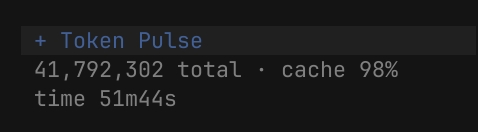
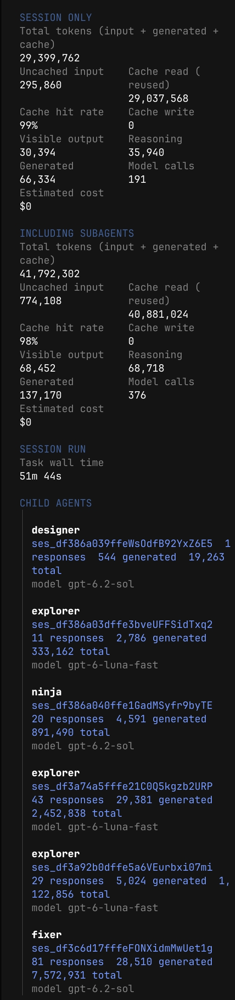

# Token Pulse

[简体中文](README.zh-CN.md)

Token Pulse shows session token usage, cache hit rate, cost, and task time in
OpenCode's sidebar.



Requires **OpenCode V2, 2.0.27 or later**.

## Features

- View usage for the current session and its child agents.
- Track background task time and retain recorded statistics across restarts.
- Browse response history and inspect session-tree details.

## Install

The installer requires Bun 1.3.14 or later on `PATH` and an OpenCode CLI that
provides `opencode plugin add` and `opencode plugin update`. The `npx` option
also requires npm.

**Recommended: `bun x`**

```sh
# Install
bun x @komeijireimu/tokpulse-cli@latest setup

# Update an existing installation
bun x @komeijireimu/tokpulse-cli@latest update
```

**Alternative: `npx`**

```sh
# Install
npx @komeijireimu/tokpulse-cli@latest setup

# Update an existing installation
npx @komeijireimu/tokpulse-cli@latest update
```

`setup` adds `@komeijireimu/tokpulse@latest` to your global OpenCode configuration
or keeps the existing global entry and its options. `update` respects that
entry's version range or pin. To track npm's latest release, set the entry's
package specifier to `@komeijireimu/tokpulse@latest`.

### Configure manually

Add the npm package to `plugins` in `opencode.json` or `opencode.jsonc`:

```json
{
  "plugins": ["@komeijireimu/tokpulse@latest"]
}
```

Use `~/.config/opencode/opencode.json` for all projects, or put the file in a
project for that project only. Add Token Pulse to the existing `plugins` list
alongside any other plugins.

Open or reload OpenCode. It installs the package and loads both the usage
collector and the **Token Pulse** sidebar.

### Build from source

```sh
git clone https://github.com/KomeijiReimu/tokpulse.git
cd tokpulse
bun install --frozen-lockfile
bun run build
```

Use the checkout's absolute build path, such as `/absolute/path/to/tokpulse/dist`,
in place of the npm package name in `plugins`.

## Usage

Expand **Token Pulse** to compare the current session's own usage with its
descendants.

| View | Command | Default shortcut |
| --- | --- | --- |
| Response history | `/tps` | `Ctrl+Shift+T` |
| Session and child-agent details | `/tps-details` | `Ctrl+Shift+Y` |

Details are also available through **Token Pulse details** in the command
palette. Select an agent to inspect its usage, or use the tree summary for the
combined total. Press `Esc` or `Ctrl+C` to close.

<details>
<summary>Preview the session details panel</summary>



</details>

### Understanding the metrics

The sidebar `total` combines uncached input, cache reads/writes, output, and
reasoning tokens. The `cache` percentage is the cache hit rate: cache reads
divided by the sum of uncached input, cache reads, and cache writes. Details show
the individual token counts and cost.

Task time covers the active intervals of the session and its eligible child
agents. Overlapping parallel work counts once, and the clock stops when all
eligible work ends. Timing uses recorded activity; missing historical intervals
cannot be reconstructed.

Identified Magic Context maintenance sessions, such as historian and dreamer,
and their descendants are excluded from usage and time. For a maintenance
summary inside a user session, filtering applies to that message; the rest of
the session remains counted.

## Data

Default runtime data is stored under `.tokpulse/` in the session's directory.
Response history is `.tokpulse/data/history.jsonl`; `maxRecords` controls how
many history entries are kept. Cumulative totals are saved separately and
continue across history pruning.

When a session or child agent moves, Token Pulse reads its old and new data
together. **Keep the previous directories' `.tokpulse/` folders** so their
recorded usage and task time remain available.

Upgrades automatically migrate the default legacy data and remove the obsolete
root-level lock directory. Custom data paths retain their configured locations.

Ignore `.tokpulse/` through `.git/info/exclude` for a local rule, or `.gitignore`
to share the rule with the repository.

To have an agent maintain these exclusions, add this rule to your global or
project `AGENTS.md`:

```text
In Git repositories, ignore Token Pulse's local runtime directory .tokpulse/.
Use .gitignore for shared rules or .git/info/exclude for local-only rules.
For custom data paths inside the repository, also ignore the data files and writer-lock directories.
```

## Options

Set options in the plugin entry's `options` object:

| Option | Default | Description |
| --- | --- | --- |
| `historyPath` | `.tokpulse/data/history.jsonl` | History path, relative to each session directory or absolute. |
| `runsPath` | `runs.jsonl` beside the history file | Activity data path. |
| `maxRecords` | `1000` | Number of response-history entries to retain. |

For example, this `options` value customizes the details shortcut:

```json
{
  "keybinds": {
    "oc-tps.details": "ctrl+shift+y,<leader>y"
  }
}
```

Set `keybinds.oc-tps.details` to `false` or `"none"` to disable that shortcut.
The details command remains available.

## Development

```sh
bun test --timeout 30000
```

License: [AGPL-3.0-or-later](LICENSE).
